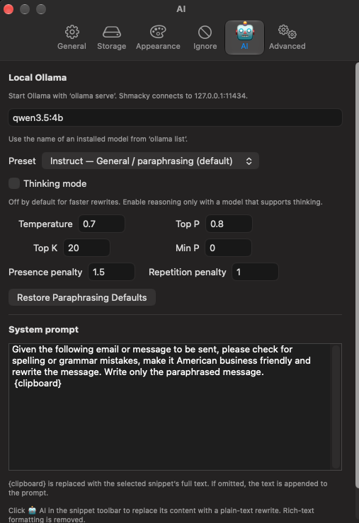

# Shmacky

**Your clipboard, with private, on-device AI rewrites.** Shmacky is a macOS clipboard manager that turns a copied email or Slack draft into a clearer message with one click.

**We forked [Maccy](https://github.com/p0deje/Maccy)**, the excellent open-source clipboard manager by [p0deje](https://github.com/p0deje) and its contributors. Shmacky builds on their work, adding local AI paraphrasing through [Ollama](https://ollama.com/) and shortcuts for moving windows between displays. This is an independent fork, not an official Maccy release.

## AI rewriting

Select a text snippet and click **🤖 AI** to replace it with a rewrite from your local model. Use **Settings → AI** to choose the model, customize the prompt, and tune generation.



- Rewrite emails and Slack messages directly from clipboard history.
- Customize the prompt using `{clipboard}` for the selected snippet's full text. If the placeholder is omitted, the text is appended.
- Turn thinking mode on or off; it is **off by default** for faster everyday rewrites.
- Adjust temperature, top-p, top-k, min-p, presence penalty, and repetition penalty.
- Choose from four presets: **Instruct — General / paraphrasing**, **Thinking — General tasks**, **Thinking — Precise coding**, and **Instruct — Reasoning tasks**.
- Keep the original snippet if generation fails or returns empty/incomplete output. A snippet edited or deleted while generation is running is not overwritten.

Successful rewrites replace the selected snippet with plain text, preserving pins and custom aliases. Rich-text formatting is removed. The system clipboard changes only when you subsequently copy or paste the rewritten snippet. Images, files, and multiple selections are not rewritten.

### Defaults for paraphrasing

The default model is **`qwen3.5:4b`**, with the **Instruct — General / paraphrasing** preset:

| Parameter | Default |
| --- | --- |
| Thinking mode | Off |
| Temperature | `0.7` |
| Top-p | `0.8` |
| Top-k | `20` |
| Min-p | `0.0` |
| Presence penalty | `1.5` |
| Repetition penalty | `1.0` |

Selecting a preset sets thinking mode and all six parameters. Manual changes appear as **Custom** and are saved for the next rewrite. **Restore Paraphrasing Defaults** restores the table above without changing your model or prompt. Shmacky maps repetition penalty to Ollama's `repeat_penalty` API option.

## Your messages stay on your Mac

**With a downloaded local Ollama model, your snippets, prompts, and AI rewrites stay on your Mac. No cloud AI account or API key is needed.** Shmacky sends rewrite requests only to the Ollama server at `http://127.0.0.1:11434/api/generate`; the model runs locally. Once the model is downloaded, rewriting can work offline.

Use a **local model**, rather than an Ollama cloud-hosted model, to keep inference on your device. You can explicitly disable Ollama's cloud features when starting the server:

```sh
OLLAMA_NO_CLOUD=1 ollama serve
```

See [Ollama's privacy and local-only configuration documentation](https://docs.ollama.com/faq#does-ollama-send-my-prompts-and-answers-back-to-ollamacom). Initial source, dependency, and model downloads require internet access.

Clipboard history is stored locally in `~/Library/Application Support/Shmacky`. It is a local database, not an encrypted vault. Shmacky uses its own preferences and bundle identifier, `org.ugoren.Shmacky`; it does not automatically import Maccy's existing history. Upstream Maccy automatic updates are disabled so they cannot overwrite this fork.

## Prerequisites

- **macOS Sonoma 14 or later.** Apple Silicon is recommended for responsive local AI; available memory and disk space must accommodate your chosen model.
- **Full Xcode**, with its license accepted and first-launch setup completed. This fork has been built and tested with **Xcode 27.2**. Apple's standalone Command Line Tools are not sufficient to build the app.
- **Git** to clone this repository.
- **[Ollama for macOS](https://ollama.com/download/mac)**, running locally, plus a downloaded model such as `qwen3.5:4b`.
- **Device Control and Data Access permission** for moving other apps' windows and automatic pasting. On older macOS versions, this permission is called **Accessibility**. AI rewriting itself does not require it.

## Setup

### 1. Start Ollama and download a model

Install Ollama, then start its local server in a terminal:

```sh
OLLAMA_NO_CLOUD=1 ollama serve
```

If the Ollama app is already serving on port `11434`, use that server instead of starting a second one. To enforce local-only mode for the Ollama app, follow [Ollama's cloud-disable instructions](https://docs.ollama.com/faq#how-do-i-disable-ollamas-cloud-features) and restart it.

In a second terminal, download the default model and confirm it is installed:

```sh
ollama pull qwen3.5:4b
ollama list
```

Keep Ollama running while using the AI button. You can choose another installed model in Shmacky's AI settings; thinking mode requires a model that supports it.

### 2. Build Shmacky

```sh
git clone https://github.com/argmaxml/shmacky.git
cd shmacky

DEVELOPER_DIR=/Applications/Xcode.app/Contents/Developer \
  xcodebuild \
  -project Maccy.xcodeproj \
  -scheme Maccy \
  -configuration Debug \
  -derivedDataPath build \
  build CODE_SIGNING_ALLOWED=NO
```

Xcode resolves the Swift package dependencies. The source directories, Xcode project, and scheme retain the upstream **Maccy** name, but the built app is **Shmacky.app**. Adjust `DEVELOPER_DIR` if Xcode is installed elsewhere.

### 3. Install and launch

Quit any running Shmacky instance before replacing the app. Then:

```sh
ditto build/Build/Products/Debug/Shmacky.app /Applications/Shmacky.app
codesign --force --deep --sign - /Applications/Shmacky.app
open /Applications/Shmacky.app
```

These instructions create an ad-hoc-signed build for your own Mac; a paid Apple Developer account is not required for this local setup. Stop Maccy or Rectangle if they are using the same global shortcuts.

### 4. Grant window-control permission

Open **System Settings → Privacy & Security → Device Control and Data Access** on macOS 27, or **Accessibility** on earlier versions. Add `/Applications/Shmacky.app` and enable it.

Shmacky runs outside App Sandbox to control other applications' windows. Rebuilding an ad-hoc-signed app can invalidate its previous permission even when the switch still appears on. If window shortcuts stop working after an update, remove Shmacky from the permission list, re-add the installed app, enable it, and restart Shmacky.

### 5. Rewrite your first snippet

1. Copy an email or Slack draft.
2. Open Shmacky with **Shift–Command–C** or its menu-bar icon.
3. In **Settings → AI**, confirm the model matches a name from `ollama list`. The paraphrasing preset is selected by default.
4. Select the text snippet and click **🤖 AI**.
5. Review the rewrite, then copy or paste it wherever you need it.

## Move windows between displays

- **Control–Option–Command–Right Arrow:** move the focused window to the next display.
- **Control–Option–Command–Left Arrow:** move it to the previous display.

Customize or clear these shortcuts in **Settings → General**. Displays cycle left to right, with wraparound; vertically aligned displays are ordered top to bottom. Window size and placement are preserved where possible, with oversized windows fitted to the destination's usable area. Native full-screen windows and windows that cannot be moved are skipped. App-imposed minimum sizes may prevent a window from fitting a smaller display.

This feature moves windows between displays; it does not add Rectangle's tiling features.

## Troubleshooting

- **Cannot connect to Ollama:** start `ollama serve` and verify the server is listening on `127.0.0.1:11434`.
- **Model not found:** run `ollama list`, download the model with `ollama pull`, and use its exact name in AI preferences.
- **Slow rewrites:** leave thinking off for short messages. Loading a model after it has been idle can take longer than subsequent requests.
- **Invalid sampling values:** correct the invalid settings; each field's help text gives its range. You can also restore the paraphrasing defaults.
- **Window shortcuts do nothing:** check Shmacky's permission and shortcut conflicts with Maccy, Rectangle, or other apps. After a rebuild, refresh the permission as described above.
- **Missing old clipboard history:** Shmacky has separate storage; your original Maccy container is left untouched.

## Development and tests

Open `Maccy.xcodeproj` in Xcode and choose the **Maccy** scheme. To run the focused AI and display-transfer tests from the repository root:

```sh
DEVELOPER_DIR=/Applications/Xcode.app/Contents/Developer \
  xcodebuild \
  -project Maccy.xcodeproj \
  -scheme Maccy \
  -configuration Debug \
  -derivedDataPath build \
  -destination 'platform=macOS' \
  -only-testing:MaccyTests/OllamaClientTests \
  -only-testing:MaccyTests/WindowDisplayMoverTests \
  test CODE_SIGN_IDENTITY=- CODE_SIGN_STYLE=Manual DEVELOPMENT_TEAM=
```

These tests cover prompt expansion, request options, sampling presets, invalid inputs, response handling, and display-transfer geometry. Live Ollama generation and multi-display behavior also require testing on a Mac with the corresponding model and displays.

## Credits and license

- **[Maccy](https://github.com/p0deje/Maccy)** by **[p0deje](https://github.com/p0deje) and contributors** is the original project we forked. Its clipboard manager, native interface, search, history, pins, and much of this codebase are their work. Thank you for making it open source. Visit the original project at [maccy.app](https://maccy.app/).
- **[Rectangle](https://github.com/rxhanson/Rectangle)** by **Ryan Hanson and contributors**, based on **Spectacle by Eric Czarny**, provided the display-transfer logic. Its MIT notice is retained in [DisplayTransfer.swift](Maccy/DisplayTransfer.swift).
- **[Ollama](https://ollama.com/)** provides the local model runtime. Models have their own licenses; consult the license for whichever model you use.

Shmacky's code is distributed under the **[MIT license](LICENSE)**. The original Maccy copyright and license notice are preserved. Please report Shmacky-specific problems in [this repository's issue tracker](https://github.com/argmaxml/shmacky/issues).
